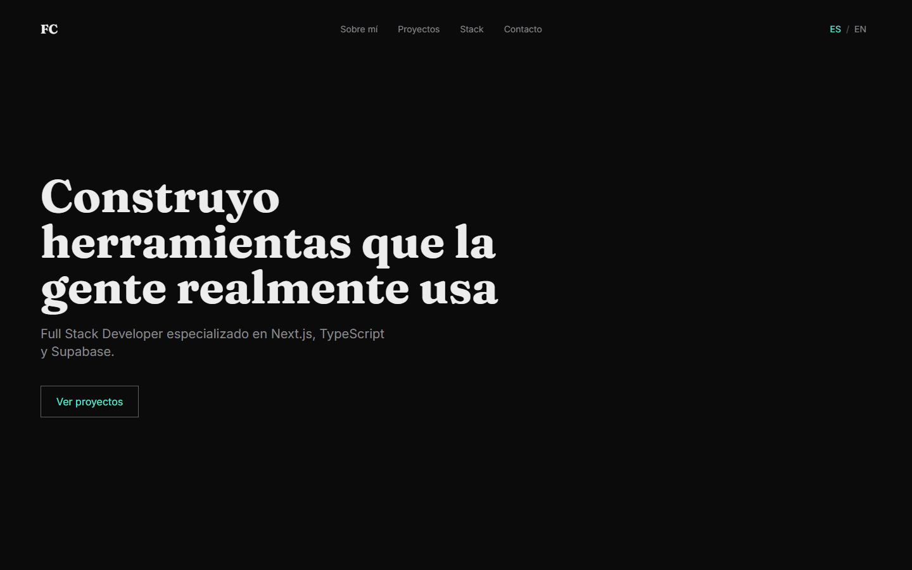
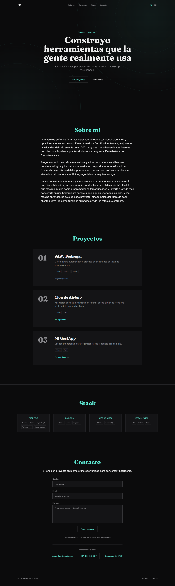
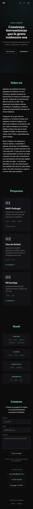

# Portfolio — Franco Cardenas

Portfolio personal bilingüe (español / inglés) de una sola página: presentación, proyectos, stack tecnológico y formulario de contacto conectado a Supabase.

**Sitio en vivo:** https://mi-portfolio-two-sooty.vercel.app



<details>
<summary>Ver página completa (desktop y mobile)</summary>





</details>

## Características

- **Bilingüe (es/en):** rutas `/es` y `/en`; la raíz `/` redirige según el idioma del navegador. Selector de idioma en el header.
- **Formulario de contacto:** validación en cliente y servidor, campo trampa anti-spam y mensajes guardados en Supabase (tabla `contact_messages` con RLS: solo se permite insertar).
- **Movimiento cuidado:** scroll suave con enlaces animados, títulos que se revelan con máscara, texto de "Sobre mí" que se ilumina al leer, tarjetas de proyectos apiladas, parallax en el Hero, fondo que reacciona a cada sección, barra de progreso y micro-interacciones. Respeta `prefers-reduced-motion`.
- **Accesible:** enlace "saltar al contenido", foco visible, navegación completa por teclado, menú mobile accesible y errores de formulario anunciados.
- **SEO y redes:** metadata por idioma, `hreflang`, Open Graph y Twitter Card con imagen generada, favicon, `sitemap.xml`, `robots.txt` y datos estructurados JSON-LD.
- **Rendimiento:** páginas estáticas por idioma. Lighthouse en producción: Accesibilidad, SEO y Buenas prácticas en 100; Performance 100 en desktop y 95–96 en mobile.

## Stack

| Área | Tecnologías |
| --- | --- |
| Framework | Next.js 16 (App Router), React 19, TypeScript |
| Estilos | Tailwind CSS 4 |
| Animación | Framer Motion, Lenis (scroll suave) |
| Internacionalización | next-intl |
| Base de datos | Supabase (PostgreSQL) |
| Despliegue | Vercel |

## Requisitos

- Node.js 20.9 o superior
- npm
- Un proyecto de [Supabase](https://supabase.com) (solo necesario para el formulario de contacto)

## Instalación

```bash
git clone https://github.com/gustavofranco26/mi-portfolio.git
cd mi-portfolio
npm install
```

Crea tu archivo de entorno a partir del ejemplo (en Windows: `copy .env.local.example .env.local`):

```bash
cp .env.local.example .env.local
```

| Variable | Descripción |
| --- | --- |
| `SUPABASE_URL` | URL del proyecto de Supabase (`https://<ref>.supabase.co`, sin `/rest/v1/`). |
| `SUPABASE_ANON_KEY` | Clave `anon` pública del proyecto. Solo se usa en el servidor. |
| `NEXT_PUBLIC_SITE_URL` | Opcional. URL pública del sitio para canonical, sitemap y Open Graph. |

Después inicia el servidor de desarrollo:

```bash
npm run dev
```

Abre http://localhost:3000 (redirige a `/es` o `/en`). Sin las variables de Supabase el sitio funciona igual; solo falla el envío del formulario.

### Base de datos del formulario

1. En el **SQL Editor** de tu proyecto de Supabase, ejecuta [`supabase/contact_messages.sql`](supabase/contact_messages.sql). Crea la tabla `contact_messages` y una política que solo permite `insert` al rol `anon`.
2. Los mensajes recibidos se ven en **Table Editor → `contact_messages`**.

## Scripts

| Comando | Qué hace |
| --- | --- |
| `npm run dev` | Servidor de desarrollo |
| `npm run build` | Build de producción |
| `npm run start` | Sirve el build de producción |
| `npm run lint` | ESLint |
| `npx tsc --noEmit` | Chequeo de tipos |

## Estructura

```
src/
├── app/
│   ├── [locale]/        layout, page, estilos globales e imagen Open Graph
│   ├── api/contact/     endpoint del formulario (POST)
│   └── icon, apple-icon, robots, sitemap
├── components/
│   ├── sections/        Hero, About, Projects, Stack, Contact
│   └── Header, Footer, ScrollProgress, ParallaxLayer…
├── content/             datos de proyectos y stack
├── i18n/                configuración de next-intl y navegación
└── lib/                 constantes del sitio, movimiento, cliente de Supabase
messages/                textos en es.json y en.json
supabase/                SQL de la tabla de contacto
docs/screenshots/        capturas de este README
```

## Contenido e idiomas

- **Textos:** todos viven en `messages/es.json` y `messages/en.json`, agrupados por sección. Cada texto nuevo se agrega con la misma clave en los dos archivos.
- **Proyectos:** se agregan en `src/content/projects.ts` (ampliando el tipo `id`) y sus textos en `Projects.items.<id>` de ambos idiomas.
- **Stack:** se edita en `src/content/stack.ts`.

## Despliegue en Vercel

El repositorio está conectado a Vercel: cada push a `main` publica automáticamente.

1. Importa el repositorio en [vercel.com/new](https://vercel.com/new).
2. En **Settings → Environment Variables** agrega `SUPABASE_URL` y `SUPABASE_ANON_KEY` (y `NEXT_PUBLIC_SITE_URL` si usas dominio propio).
3. Haz un redeploy para que las variables apliquen.

## Autor

Franco Cardenas — [GitHub](https://github.com/gustavofranco26) · [LinkedIn](https://www.linkedin.com/in/francocardenas/)
